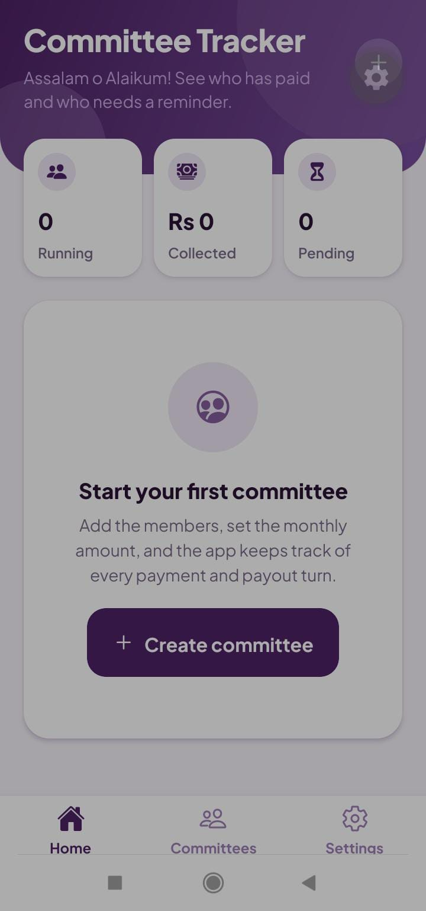
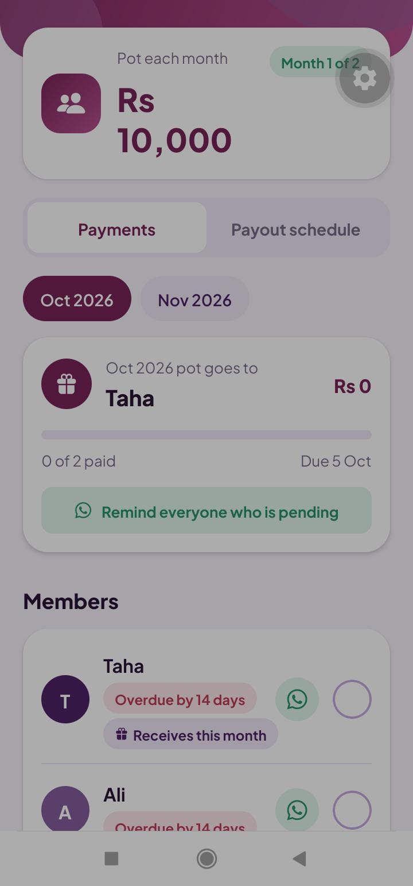
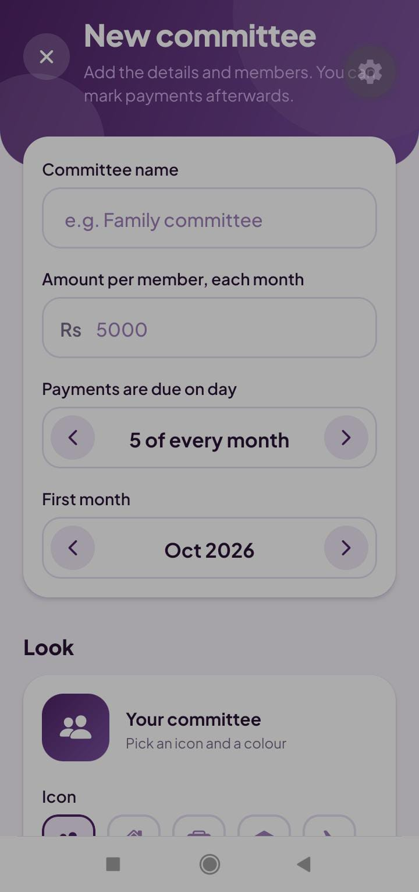
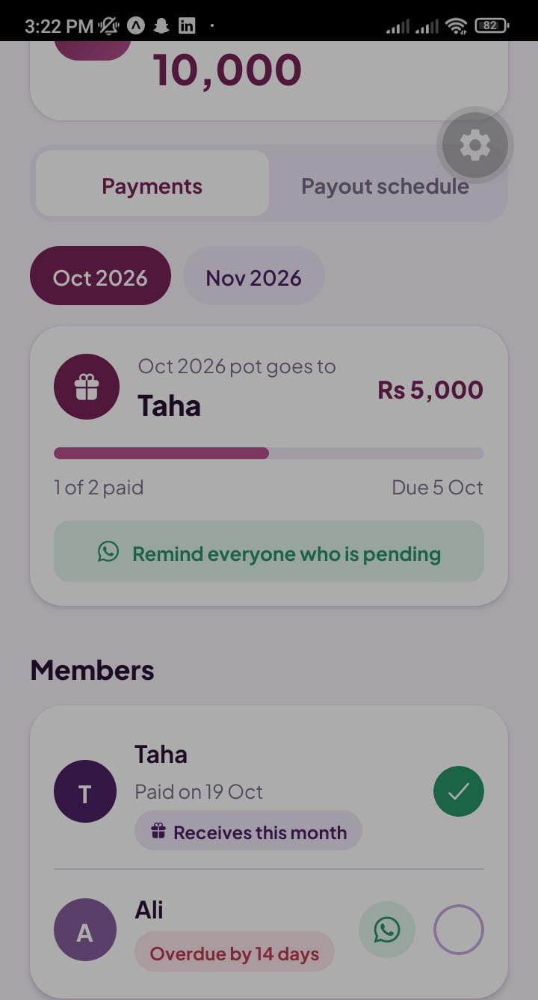
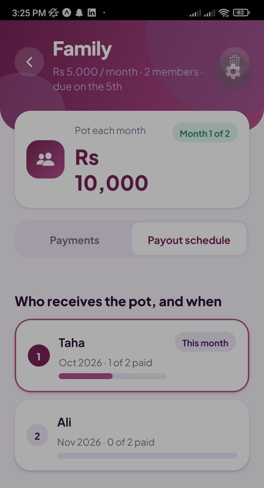

# Committee Tracker

A mobile app for tracking **committees (BC)**, the rotating savings groups common in Pakistan and South Asia. Members contribute a fixed amount every month, and each month one member receives the whole pot.

Committee Tracker keeps the notebook for you: who is in the group, who has paid this month, whose turn it is to receive the pot, and who needs a reminder.

> The app does **not** process any money. It only records payments and helps you send reminders. There is no account, no server, and no payment gateway. Everything stays on your phone.

## Screenshots

| Home | Committees | New committee |
| --- | --- | --- |
|  |  |  |

| Payments | Payout schedule |
| --- | --- |
|  |  |

## Features

**Run any number of committees**
- Create a committee with a name, monthly amount, due day (1 to 28), and start month.
- Add members with an optional WhatsApp number.
- Set the payout order by hand (move members up or down) or draw a random order.
- A summary shows the monthly pot and the month the committee ends.
- Give each committee its own icon and colour.

**Track every payment**
- Month picker for the whole life of the committee.
- Tap a member to mark their payment as received, and tap again to undo.
- See who receives the pot each month, how much has been collected, and who is overdue.
- A payout schedule shows every month, its recipient, and its progress at a glance.

**Remind people in one tap**
- Send a pre-filled WhatsApp reminder to a member who has not paid. No API or account needed.
- Share one summary message listing everyone still pending, ready to post in the group chat.

**Dashboard**
- The home screen shows running committees, the amount collected this month, and a "Needs a reminder" list sorted by how overdue each person is.
- Each running committee shows this month's recipient and payment progress.

**Your data, your phone**
- Works fully offline and keeps your data between launches.
- Back up your committees as text and restore them on another phone.
- Erase all data from Settings at any time.

**Polished mobile experience**
- Purple gradient theme and Plus Jakarta Sans typography.
- A paid-button animation, haptic feedback, animated progress bars, and a confetti celebration when everyone has paid for a month.

## Tech stack

- [React Native](https://reactnative.dev/) with [Expo](https://expo.dev/) (SDK 57) and TypeScript
- [Expo Router](https://docs.expo.dev/router/introduction/) for file-based navigation (tabs and stack)
- [Zustand](https://github.com/pmndrs/zustand) with AsyncStorage for state that persists on the device
- `expo-linear-gradient`, `expo-haptics`, and `@expo/vector-icons`
- `@expo-google-fonts/plus-jakarta-sans`

## Project structure

```
src/
  app/
    _layout.tsx            Root layout: loads fonts and saved data
    (tabs)/                Home, Committees, Settings tabs
    committee/
      new.tsx              Create a committee
      [id].tsx             Payments and payout schedule
  components/
    ui.tsx                 Shared UI: header, cards, buttons, inputs
    effects.tsx            Paid-button animation and confetti
  lib/
    committee.ts           Committee logic (months, due dates, progress)
    dates.ts               Date helpers
    format.ts              Money and name formatting
    identity.ts            Committee icons and colours
    whatsapp.ts            WhatsApp reminder messages
  store/
    useStore.ts            Persisted state, backup, and restore
  theme.ts                 Colours, fonts, and spacing
```

## How it works

A committee with *n* members runs for *n* months. The member at position *i* in the payout order receives the pot in month *i*. Payments are stored as a simple map of `"monthIndex:memberId"` to the date they were marked, which keeps the data small and makes backup and restore a single JSON file.

## Getting started

You need [Node.js](https://nodejs.org/) (an LTS version, 22 or 24, is recommended) and the **Expo Go** app on your Android or iOS phone.

```bash
git clone https://github.com/ayeshakhan69673-source/committee-tracker.git
cd committee-tracker
npm install
npx expo start
```

Scan the QR code with Expo Go. Your phone and computer need to be on the same Wi-Fi network. Use the Expo Go version that supports SDK 57.

## Ideas for later

- Local notifications on due dates
- Urdu language support
- Editing members after a committee is created
- A khata (ledger) module for tracking money lent and owed

## Author

Built by **Ayesha Khan**, a Computer Science graduate and full-stack developer.

- GitHub: [ayeshakhan69673-source](https://github.com/ayeshakhan69673-source)
- LinkedIn: [ayesha-khan-dev](https://www.linkedin.com/in/ayesha-khan-dev)
